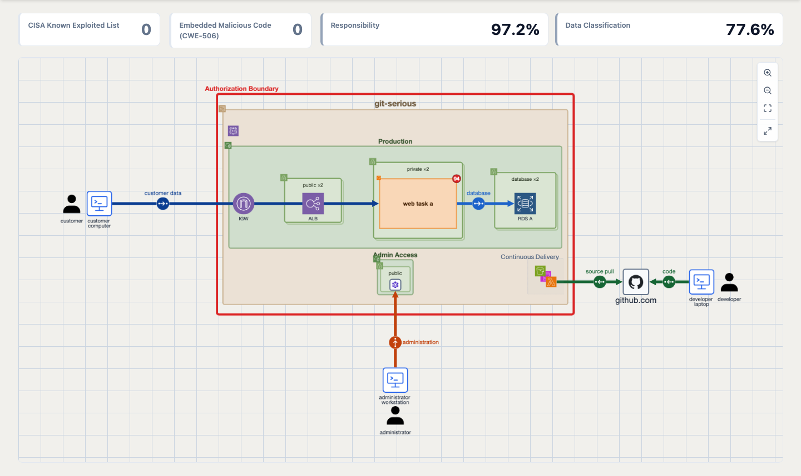
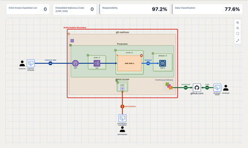
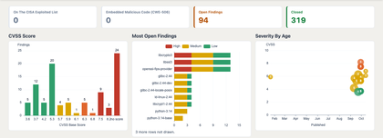
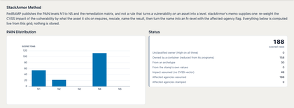
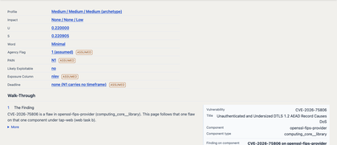
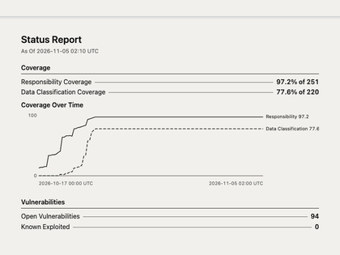
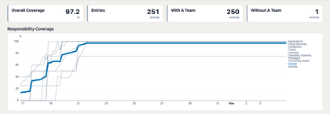

# Rampart 20x Playground

> **Early-release software.** This is a working prototype. Pages change often, some are unfinished, and the specs are still moving. The vulnerabilities are real, the deployment is a mock-up. The code is published publicly to demonstrate capabilities in flight now and gather collaborators working on FedRAMP 20x vulnerability detection and response (VDR). If you're interested in participating please reach out to [george@criticalsec.com](mailto:george@criticalsec.com).



## What this is

FedRAMP 20x VDR requires a provider to evaluate every vulnerability on every asset: assign a Potential Agency Impact level (PAIN, N1 to N5) and meet the remediation time that level carries. FedRAMP publishes the levels and the timeframe matrix. It does not publish how to get from one vulnerability on one asset to a level.

This playground is an instance of [TAP, The Analogy Platform](https://github.com/unified-systems-com/tap) ([TAP in two pages](https://github.com/unified-systems-com/tap/blob/main/docs/doc-tap-intro.md)). TAP models the systems you are responsible for as a graph (nodes, edges, history and provenance) that people and AI agents query and extend. Here the graph holds a mock cloud deployment, its software, its vulnerabilities and findings, its teams, and the VDR answers computed from them. It demonstrates three things:

- **Evidence.** An evaluation records who decided, when, and the evidence behind it. Without evidence it stays at the worst case.
- **Coverage.** Progress is measured, not asserted: the share of inventory with a responsible team and with the right data classification, per category, recorded every hour.
- **Several VDR implementations on the same data.** Two run today: a worst-case baseline (VDR MAX), and the method published by Matthew Venne of stackArmor. More can be added, and compared on the same findings.

Everything domain-specific in TAP is a plugin, so a method, a collector, a page or a report can be adapted by an AI agent working from the specs, or built as a new plugin.

## The pages

<table>
<tr>
<td align="center" valign="top"><a href="docs/images/01-overview.png"></a><br><sub><b>Overview</b><br>the mock deployment</sub></td>
<td align="center" valign="top"><a href="docs/images/02-vulnerabilities.png"></a><br><sub><b>Vulnerabilities</b><br>open and closed counts, CVSS and age</sub></td>
<td align="center" valign="top"><a href="docs/images/04-stackarmor.png"></a><br><sub><b>StackArmor</b><br>PAIN distribution, every finding scored</sub></td>
</tr>
<tr>
<td align="center" valign="top"><a href="docs/images/05-finding-walkthrough.png"></a><br><sub><b>Finding walk-through</b><br>one vulnerability, twelve steps</sub></td>
<td align="center" valign="top"><a href="docs/images/06-reporting.png"></a><br><sub><b>Reporting</b><br>agency part and internal part</sub></td>
<td align="center" valign="top"><a href="docs/images/07-coverage.png"></a><br><sub><b>Coverage</b><br>per category, hourly</sub></td>
</tr>
</table>

<sub>Click a thumbnail for the full-size screenshot.</sub>

| Page | Contents |
| --- | --- |
| **Overview** | The mock deployment (an AWS GovCloud account hosting the `git-serious` service, inside its authorization boundary) drawn from the graph, with cards for open known-exploited vulnerabilities, embedded-malicious-code findings and the two coverage figures. The red badge on a component is its count of open findings. |
| **Vulnerabilities** | Cards, charts and tables of every open vulnerability and affected component. A CVE page gives its score, exploitation signals, and the components and systems here that carry it. |
| **VDR MAX** | The baseline method. Each open finding gets an evaluation at the worst case (likely exploitable, internet-reachable, highest PAIN); a factor is lowered only by an evaluation backed by evidence. Shows the rules, counts, one finding's evaluation and the remediation clocks computed from FedRAMP's timeframe tables. No evidence is attached in the demo, so expect the clocks to read overdue. |
| **StackArmor** | The stackArmor method: the vulnerability's CVSS impact combined with what the asset requires for confidentiality, integrity and availability gives a PAIN level. Shows the formula, the whitepaper's five worked examples as data, every finding scored, and how many results rest on an assumption. |
| **Finding walk-through** | Opened from any row of the StackArmor findings table. One vulnerability on one component under one owner, in twelve steps from the finding to its deadline, with each value carried down and every assumed value marked. |
| **Reporting** | A print-ready status report in two parts, an agency part and an internal part below a cut line, with coverage figures, coverage trends and a countdown to 7 December 2026. |
| **Inventory, Data Classification, Teams** | The mock inventory in nine tables, the kinds of data it holds and which components carry each, and the teams that own things. The coverage charts are drawn here. |


## Where the data comes from

The deployment is a mock: accounts, resources, people and laptops are invented, and a keystone node in the graph says so. The vulnerabilities and findings are real, and static. They were generated from the CycloneDX SBOM, with vulnerability data, that TAP's own build produced for a published `tap-web` container image, and from a snapshot of the code-scanning and Dependabot alerts on TAP's repository. They are attached to components of the mock deployment so the methods have something to evaluate. Nothing is collected live from a real system.

## Try it

[](https://codespaces.new/unified-systems-com/rampart-20x-playground-tap)

This opens your own private instance of the playground in a GitHub Codespace. When it asks, sign in with the GitHub account that opened it; the playground pages are under `/playground`.

**Connect your own agent or shell.** Choose the maintainer configuration when you create the Codespace (Code, Codespaces, New with options, then the configuration named "Rampart 20x Playground - maintainer"). It adds a Debian dev box beside the app with ssh, git, the GitHub CLI and Docker access to the running instance. Then, from your machine:

```
gh codespace ssh -c <name> -- bash -lc 'cd /workspace && git pull && docker ps'
```

Use `bash -lc` so the command gets the Codespace's GitHub credential for `git push` and `gh`. The repository is at `/workspace`; the app containers are `web` and `db`, reached with `docker exec`.

To learn more or to talk about applying this to your own VDR work, write to [george@criticalsec.com](mailto:george@criticalsec.com).

## Run it locally

You need git, Docker (Docker Desktop, or Docker Engine with the Compose v2 plugin) and Python 3 on the host. The instance runs in containers; nothing is installed on the host.

```bash
mkdir -p ~/tap-sessions
git clone https://github.com/unified-systems-com/tap ~/tap-sessions/main
cd ~/tap-sessions/main
scripts/spawn-session.sh playground --from 'git+https://github.com/unified-systems-com/rampart-20x-playground-tap@v0.2.0#demo'
```

The script fetches this repository's demo record at the tagged release, checks it against its published digest, pulls the TAP images, installs the plugins the record pins from their public repositories, seeds the data and starts the hourly jobs. The first run takes several minutes. When it finishes it prints the URL and the sign-in details; the instance opens on `/playground`. The hourly jobs fetch the KSI catalogue and public vulnerability data, so the instance needs outbound network access. To remove it: `scripts/despawn-session.sh playground`.

TAP's own [README](https://github.com/unified-systems-com/tap#get-it-running) covers host prerequisites for Linux and what a session is.

## Under the hood

This repository is a data-only instance plugin, `rampart_20x_playground`. It ships no code: only seed data, pages and panel configuration for the plugins it composes.

| Plugin | Contribution |
| --- | --- |
| `aws_core`, `computing_core`, `git_core`, `github_core`, `identity_core` | Vocabulary for the deployment: cloud resources, programs and packages, repositories, people |
| `compliance_core` | Findings, vulnerabilities, coverage measures and the report panel |
| `fedramp_20x_vdr` | Evaluations, evidence, timeframes and deadlines; the VDR MAX method |
| `stackarmor_vdr` | The stackArmor method and the finding walk-through |
| `fedramp_20x_ksi` | The Key Security Indicator catalogue (KSI pages are later work) |
| `vuln_mosaic` | Public vulnerability data: CVSS, KEV, EPSS |

Pages are panels that read Searches, which are graph queries or small Python runners. Nothing the pages show is stored as a verdict: PAIN levels, clocks and coverage are computed from the graph when a page loads. Three hourly jobs record coverage snapshots, refresh the KSI catalogue and refresh public vulnerability data. The plan is `specs/spec-rampart_20x_playground-v0.md`; the other files in `specs/` cover individual pages.

## Credits

The StackArmor page implements the published method of Matthew Venne and stackArmor: [the whitepaper](https://stackarmor.github.io/rfc-fedramp-vdr/vdr-pain-cvss.pdf), [the site](https://stackarmor.github.io/rfc-fedramp-vdr/) and [the source](https://github.com/stackArmor/rfc-fedramp-vdr). Thank you to Matthew and stackArmor for publishing it in a form that could be tested against. The method is theirs; errors in this implementation are ours. Nothing here is affiliated with or endorsed by stackArmor or FedRAMP.

Developed with AI coding assistance (Claude Code) under the direction of the maintainer; each pull request records what was run and what was not.

## Licence

Apache-2.0, see `LICENSE`.

<details>
<summary>Developer notes: display data the Overview reads</summary>

- **`icon_angle`** (dimension of an application flow, degrees): the way the flow points. **0 = north / up, 90 = east, 180 = south, 270 = west**
  (default 90). The Overview turns only the flow's circle icon (the data marker) to it. Arrows always point from the session initiator (the flow's source) to the target (its destination): the arrowhead is on the destination end whatever the angle. Today: `source pull` 270,
  `code` 270, `administration` 0, `customer data` and `database` 90. It is a marked playground exception in `landing.js`
  (exception 38) that becomes a per-node `icon_angle` display hint in tap_viz.

</details>
